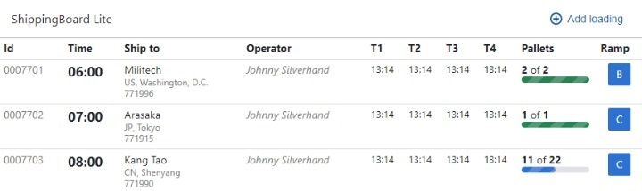

The mini board made the React rendering rules visible. Now apply them to the original ShippingBoard Lite: add a ramp dashboard while preserving its working table, details dialog and Sass. This application is the chapter’s main project; lessons 5.5–5.15 form one required continuation.

This page establishes the only source checkpoint for the original-app sequence. The mini editor is not used for lessons 5.5–5.15.

Mini fixture: 3 records / React state. Original app: 11 loadings / MobX models.

## Prepare and inspect

The original starting table is:



The [public demo](https://adam-zielonka.github.io/shippingboard-lite/) illustrates the project; it can change independently of this lesson. Our reproducible starting point is the `create-ramp-view` branch at commit [`3634bcb9a1ee0ecf8bd9e956550970ff159a6c99`](https://github.com/adam-zielonka/shippingboard-lite/tree/3634bcb9a1ee0ecf8bd9e956550970ff159a6c99). This checkpoint retains the old component API and styling even though its tooling dependencies have been updated since the original lesson.

Use Node.js 24 and an installed `pnpm` command. The checkpoint has a version 6 pnpm lockfile; invoking pnpm 8 explicitly keeps that dependency resolution. In your development directory, create a new checkout:

```shell
node --version
pnpm --version
git clone --branch create-ramp-view https://github.com/adam-zielonka/shippingboard-lite.git shippingboard-lite-ramp-lesson
cd shippingboard-lite-ramp-lesson
git switch --detach 3634bcb9a1ee0ecf8bd9e956550970ff159a6c99
git switch -c lesson/ramp-dashboard
pnpm dlx pnpm@8.15.9 install --frozen-lockfile
pnpm dlx pnpm@8.15.9 run dev
```

Open the local address printed by Vite, normally `http://localhost:5173`. The command is `run dev`; the old tutorial's `npm dev` was incorrect. An alternative online starting point is [StackBlitz at the same commit](https://stackblitz.com/github/adam-zielonka/shippingboard-lite/tree/3634bcb9a1ee0ecf8bd9e956550970ff159a6c99); use the local workflow above for the verified build path. Do not start from today's `main`: its components and dependencies differ.

In a second terminal in the same checkout, establish the baseline:

```shell
pnpm dlx pnpm@8.15.9 run build
```

This script runs TypeScript and then Vite. Repeat it after each following lesson; these are edits to the original app, not exports from a mini-lesson.

Read these existing files before changing them:

| File | What is already there |
| --- | --- |
| `src/store/Store.ts` | One `store` singleton; initializes customers, ramps, loadings, then `ui.init()`; exposes `window.store` for inspection. |
| `src/store/UI.ts` | `makeAutoObservable`, a `View` type, loading-dialog actions, URL restoration of the selected loading and an `addQueryParam` helper. The `view` field and view actions are missing. |
| `src/store/Loading.ts` | A `Loading` class with dates, customer lookup, pallet counters, progress getters and ramp actions. |
| `src/store/Ramp.ts` | A `Ramp` class with ID, description and `makeAutoObservable`. Its extension is **`.ts`**, not `.tsx`. |
| `src/api/api.ts`, `src/api/parse.ts`, `src/api/fakeApi.ts` | Synchronous local data mapped into class instances; loading ramp IDs resolve to objects in `store.ramps`. No backend setup is needed. |
| `src/components/Header.tsx`, `Content.tsx`, `Details.tsx` | Existing navbar, table selection point and assignment dialog. |
| `src/components/Content.scss`, `Ramp.scss`, `Details.scss` | Original layout, ramp/card styles and dialog styles. `Ramp.scss` exists but is not yet imported. |

Unlike the mini app's plain records and local `useState`, this application uses observable class instances and shared UI state. `loading.ramp` is a `Ramp` object or `undefined`, not a ramp ID string. It uses React 18, MobX 6 and **Blueprint `@blueprintjs/core` 4.20.2** from the lockfile. Keep Blueprint 4 for this exercise: the existing Sass selectors include `.bp4-card` and `.bp4-dialog`. Upgrading Blueprint or copying components from current `main` would be a separate migration.

## Check your workspace

In the running app, open one of the eleven table rows: its details dialog opens, with **Add loading** still available in the header after you close it. The baseline build above must finish successfully before you edit the project.

Keep this checkout open through lesson 5.15. The online alternative must likewise keep the same project session and files; it does not have separate start/solution checkpoints for these stages. Browser mini-lesson drafts do not transfer into this repository.
