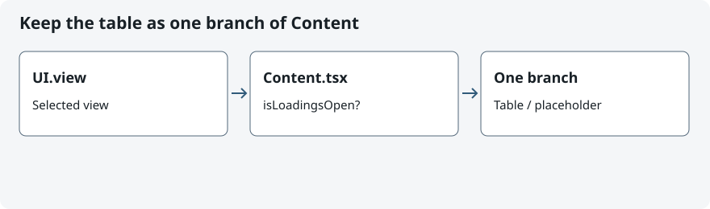

The header now changes the view choice, but the content still always shows the table. Make the existing Content component read that same choice before adding any ramp UI.

Work in the **same `shippingboard-lite-ramp-lesson` checkout** prepared in [5.5](./05-original-workspace.mdx), carrying forward the preceding lesson’s edits. Edit the `src/` files named below in your local editor (or the same online project session), not the mini board. After editing, run `pnpm dlx pnpm@8.15.9 run build` in that checkout; the observable check uses its running app.



App still renders Header + Content + Details. The shared dialog stays mounted.

## Make the change

Replace `src/components/Content.tsx` with this complete, deliberately small intermediate version:

```tsx title="src/components/Content.tsx — view switch"
import { observer } from "mobx-react-lite";
import { store } from "../store/Store";
import { LoadingsTable } from "./LoadingsTable";
import "./Content.scss";

export const Content = observer(() => {
  const { ui } = store;

  if (ui.isLoadingsOpen) {
    return <LoadingsTable />;
  }

  return <div className="Content">Ramps will appear here.</div>;
});
```

The early return keeps the working table as one branch. The other branch will become the ramp board. `App.tsx` already renders `Header`, `Content` and `Details`; leave it unchanged so the same dialog can serve both views.

## Check your work

Loadings shows the original table, Dashboard shows the temporary sentence, and opening a table row still shows its details. View selection now changes both the header and content.
