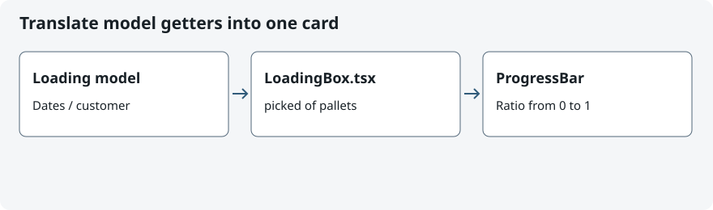

Each ramp needs a readable loading summary. Build one card from the original Loading model before connecting ramp assignments; its dates, customer and numeric pallet progress are richer than the mini fixture’s category stripe.

Work in the **same `shippingboard-lite-ramp-lesson` checkout** prepared in [5.5](./05-original-workspace.mdx), carrying forward the preceding lesson’s edits. Edit the `src/` files named below in your local editor (or the same online project session), not the mini board. After editing, run `pnpm dlx pnpm@8.15.9 run build` in that checkout; the observable check uses its running app.



Temporary preview: the same 0007701 card in every ramp; assignments come next.

## Make the change

Create `src/components/LoadingBox.tsx`:

```tsx title="src/components/LoadingBox.tsx"
import { Card, Elevation, ProgressBar } from "@blueprintjs/core";
import { observer } from "mobx-react-lite";
import { Loading } from "../store/Loading";

export const LoadingBox = observer(({ loading }: { loading: Loading }) => {
  const { customer } = loading;

  return <Card className="Loading" elevation={Elevation.TWO} interactive>
    <header>
      <div>{loading.id}</div>
    </header>
    <main>
      <div className="details">
        {loading.start.date}
        <div>
          <span>{loading.start.time}</span>–{loading.end.time}
        </div>
      </div>
      <div className="customer">
        {customer && <>
          <div className="name">{customer.name}</div>
          <div className="city">{customer.country}, {customer.city}</div>
          <div className="id">{customer.id.replace(/^0+/, "")}</div>
        </>}
      </div>
    </main>
    <footer>
      <div><b>{loading.picked}</b> of <b>{loading.pallets}</b></div>
      <ProgressBar animate={false} value={loading.loadedRatio}
        intent={loading.isLoaded ? "success" : "primary"} />
    </footer>
  </Card>;
});
```

Use the model's existing presentation getters rather than interpreting raw API fields in the component:

| Card value | Existing model mapping |
| --- | --- |
| Loading ID | `loading.id`, originally `loading_id` in `fakeApi.ts`. |
| Date and time window | `loading.start.date`, `start.time` and `end.time`, formatted by `DateTime`. |
| Customer | `loading.customer`, resolved through the first delivery's `ship_to` relationship. Guard it because a loading can have no deliveries. |
| Customer name, location and ID | `customer.name`, `country`, `city`, `id`; remove leading zeroes only in the displayed customer ID. |
| Pallet counts | `picked` from `picked_hus`, and `pallets` from the API's total. The card reads picked **of** total. |
| Progress | `loadedRatio`: `picked / pallets`, with `0` when the total is zero; `isLoaded` requires a positive total and exact equality. |

Blueprint's [`ProgressBar` value is a ratio from 0 to 1](https://github.com/palantir/blueprint/blob/%40blueprintjs%2Fcore%404.20.2/packages/core/src/components/progress-bar/progressBar.tsx), not a percentage from 0 to 100. We pass the existing numeric getter, turn off animation and use success intent only for a completed loading. This differs from the mini app's categorical status stripe.

For a short visual check before connecting the relationship, add these imports to `RampBox.tsx`:

```tsx title="src/components/RampBox.tsx — temporary imports"
import { store } from "../store/Store";
import { LoadingBox } from "./LoadingBox";
```

Then replace its entire `<main>Loadings will appear here.</main>` with:

```tsx title="src/components/RampBox.tsx — temporary single loading"
<main>
  <LoadingBox loading={store.loadings[0]} />
</main>
```

The pinned data guarantees a first loading; this is a temporary component check, not the final assignment logic.

## Check your work

every ramp temporarily shows the **same** `0007701` card: Militech, US/Washington, D.C., customer ID `771996`, `2 of 2` and a full success bar. The dates follow the local current day and the time window is 06:00–09:00. The `.Loading` styles apply because the card is inside `.Ramp`. Clicking is not connected yet. If you see duplicated cards, that is expected at this intermediate step; fix the relationship next.
