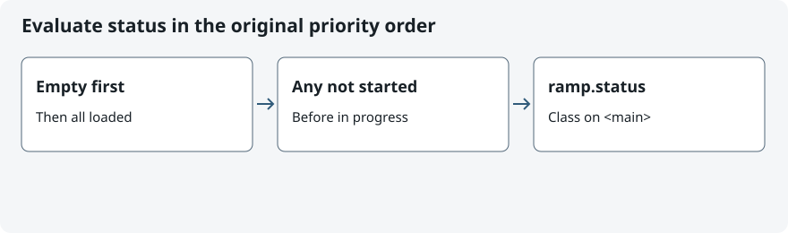

An assigned card list does not yet describe whether the ramp is ready, finished or waiting. Derive that business status from all assignments and connect it to the existing body colour rules.

Work in the **same `shippingboard-lite-ramp-lesson` checkout** prepared in [5.5](./05-original-workspace.mdx), carrying forward the preceding lesson’s edits. Edit the `src/` files named below in your local editor (or the same online project session), not the mini board. After editing, run `pnpm dlx pnpm@8.15.9 run build` in that checkout; the observable check uses its running app.



Zero-picked overlaps with isInProgress. E stays red until its waiting loading moves.

## Make the change

A ramp's status describes **all its assigned loadings**, independently of which view is open. Replace `src/store/Ramp.ts` with this complete version, retaining the relationship getter:

```ts title="src/store/Ramp.ts — status"
import { makeAutoObservable } from "mobx";
import { Loading } from "./Loading";
import { store } from "./Store";

export type Status = "empty" | "loaded" | "progress" | "not-started" | "";

export class Ramp {
  constructor(
    public id: string,
    public description: string,
  ) {
    makeAutoObservable(this);
  }

  get loadings(): Loading[] {
    return store.loadings.filter(loading => loading.ramp === this);
  }

  get isEmpty(): boolean {
    return this.loadings.length === 0;
  }

  get isLoaded(): boolean {
    return this.loadings.every(loading => loading.isLoaded);
  }

  get isInProgress(): boolean {
    return this.loadings.some(loading => loading.isInProgress);
  }

  get isSomeNotStarted(): boolean {
    return this.loadings.some(loading => !loading.isStarted);
  }

  get status(): Status {
    if (this.isEmpty) return "empty";
    if (this.isLoaded) return "loaded";
    if (this.isSomeNotStarted) return "not-started";
    if (this.isInProgress) return "progress";
    return "";
  }
}
```

In `src/components/RampBox.tsx`, change its opening `<main>` tag to:

```tsx title="src/components/RampBox.tsx — status class"
<main className={ramp.status}>
```

Keep the class on the ramp's **body**, where the existing `Ramp.scss` selectors expect it. Its `loaded`, `progress` and `not-started` rules provide green, amber and red backgrounds. There is no filled `.empty` rule: empty ramps keep their striped background. Do not rewrite the stylesheet.

The order is deliberate. An empty array satisfies `every`, so `isLoaded` alone is true for an empty ramp; the `isEmpty` branch must run first. Any not-started assignment takes precedence over a partially picked assignment. Also inspect the original `Loading` getters: `isInProgress` means `picked !== pallets`, so a positive-total loading with zero picked pallets satisfies it too. The earlier `isSomeNotStarted` branch resolves that overlap. We preserve those model semantics rather than substituting the mini fixture's status strings.

## Expected fixture status

After a fresh reload, expect:

| Ramp | Assigned progress | Status and appearance |
| --- | --- | --- |
| A, F, G | No loadings | `empty`, striped. |
| B | `2/2` | `loaded`, green. |
| C | `1/1` and `11/22` | `progress`, amber. |
| D | `14/36`, `3/6`, `5/7` | `progress`, amber. |
| E | `0/42` and `3/29` | `not-started`, red. |

## Check your work

E must be red even though `0007708` has started. This original rule is **Not started before In progress**; the four mini-lessons intentionally use a different **Loading before Waiting** rule. Do not copy that priority here. Open `0007707`, move it to A and close: A becomes red and E becomes amber. Move it back to restore the initial distribution, or reload.
