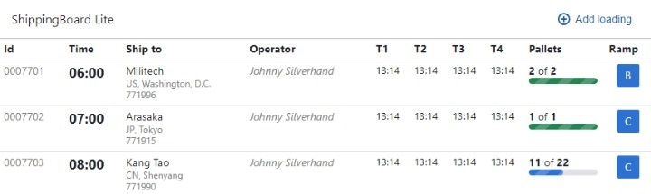
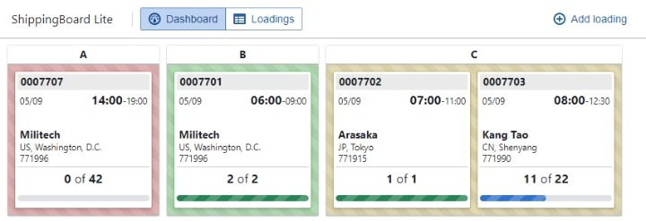

# 5. ShippingBoard Lite

Compose a small board from the fixed loading and ramp fixtures. React state holds view/filter choices; visible rows and ramp status are derived from the records. Each mini-lesson carries the previous solution forward.

The examples isolate view and ramp concepts from the [original ShippingBoard Lite project](https://github.com/adam-zielonka/shippingboard-lite) without its backend or older UI dependencies. The fixture is intentionally local: it does not implement persistence, editing assignments, or a production shipping system.

## Lessons

1. [Switch between board views](./05-shippingboard/01-view-switching.mdx) — Connect view selection to two presentations of the same data.
2. [Filter loading status](./05-shippingboard/02-status-filter.mdx) — Derive visible rows from a controlled status selector.
3. [Group loadings by ramp](./05-shippingboard/03-ramp-groups.mdx) — Render each ramp with its matching visible assignments.
4. [Explain empty ramps and ramp status](./05-shippingboard/04-empty-and-status.mdx) — Distinguish an available ramp from a filter with no matches.

In a local export, editor `/App.tsx` is `src/App.tsx`; other editor paths likewise live under `src` unless identified as public files. Work in order. Each lesson has its own starter, focused editor, and preview. The previous solution forms the next starter within the chapter; your saved edits remain scoped to the lesson where you made them.

## Official references

[React rendering lists](https://react.dev/learn/rendering-lists), [conditional rendering](https://react.dev/learn/conditional-rendering), [choosing state structure](https://react.dev/learn/choosing-the-state-structure).

## Optional continuation: original ShippingBoard Lite

The original [demo](https://adam-zielonka.github.io/shippingboard-lite/) and [source checkpoint](https://github.com/adam-zielonka/shippingboard-lite/tree/create-ramp-view) use MobX models, Blueprint cards, dates, customers and pallet quantities absent from the mini fixture. Compare the starting table and intended dashboard:

In that checkpoint, `src/store/UI.ts` holds a `view` union (`dashboard` or `loadings`), getters such as `isLoadingsOpen`, and actions such as `openLoadings`. `src/components/Header.tsx` calls those actions and reflects the selected view; `Content.tsx` selects the table or dashboard. This parallels the mini app's local state, but is shared with the original store.

To restore a chosen view from a link, read `new URLSearchParams(window.location.search).get('view')` in `UI.init`, accept only known values, and use a MobX `reaction` to write later changes with the project's `addQueryParam` helper. A validated default avoids accepting arbitrary URL values. See [URLSearchParams](https://developer.mozilla.org/en-US/docs/Web/API/URLSearchParams) and [MobX reactions](https://mobx.js.org/reactions.html); dispose reactions if their owner has a shorter lifetime than the application.

The original `src/components/RampBox.tsx` receives a `Ramp` model and `Content.tsx` maps `store.ramps` to keyed boxes. In `src/store/Ramp.tsx`, a computed `loadings` getter can return `store.loadings.filter(l => l.ramp === this)`. Render those as keyed `LoadingBox` components. The original `LoadingBox.tsx` shows the loading ID, start/end time, optional customer name, city and ID, picked versus total pallets, and a progress bar from `loadedRatio`; its click calls `store.ui.openLoadingDialog(loading)`. These are model relationships and a numeric ratio, unlike the mini fixture's categorical stripe.

For the original status, check empty first, then all loaded, then any not started, then in progress; use the resulting class on the ramp body. That original priority differs from the mini board's Loading-before-Waiting rule. A `quantity` getter returns `this.loadings.length`; in `src/components/Details.tsx` show it beside each ramp choice and use the original empty/current/occupied intent to help choose an assignment. Test an empty ramp and a ramp with mixed loading states before relying on the colours.
